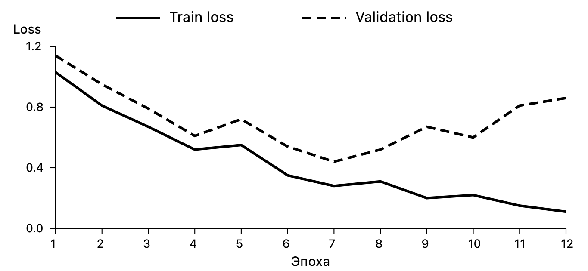

# Тест: основы машинного обучения

Имя и фамилия: ____________________________

## 1. Нормальное уравнение

Для линейной регрессии градиент ошибки равен Xᵀ(Xw − y).  
Приравняйте его к нулю и запишите уравнение в виде Aw = b.  
Что нужно проверить у A, прежде чем записывать решение w = A⁻¹b?

## 2. Два признака в модели цены квартиры

После стандартизации общая площадь x₁ и жилая площадь x₂ обычно близки.  
На двух выборках получили прогнозы 8x₁ − 5x₂ и −4x₁ + 7x₂.  
а) Вычтите один прогноз из другого. Почему прогнозы близки, а веса разные?  
б) Зафиксируем вес общей площади. Пусть ошибка как функция веса w  
жилой площади равна (w − 0,5)². Добавьте к ней штраф |w| (L1) или w² (L2).  
Для каждого штрафа сравните итоговые значения при w = 0; 0,25; 0,5.  
Какой вес из трёх выберет каждый штраф? Какой уберёт признак из модели?

## 3. Как история градиентов влияет на шаг

Первые четыре значения ∂L/∂w₁:  +8, −8, +8, −8.  
Первые четыре значения ∂L/∂w₂:  −1, −1, −1, −1.  
а) По какому весу Momentum накапливает движение в одном направлении?  
Что происходит с вкладами по другому весу?  
б) Для какого веса RMSProp сильнее уменьшает множитель перед текущей  
частной производной? Почему вклады разных знаков не компенсируются?

## 4. Переобучение

На 5-й эпохе validation loss вырос. Достаточно ли этого, чтобы говорить  
о переобучении? Что видно на следующих эпохах?  
После какой эпохи вы бы сохранили веса? Объясните, почему не после 12-й.

